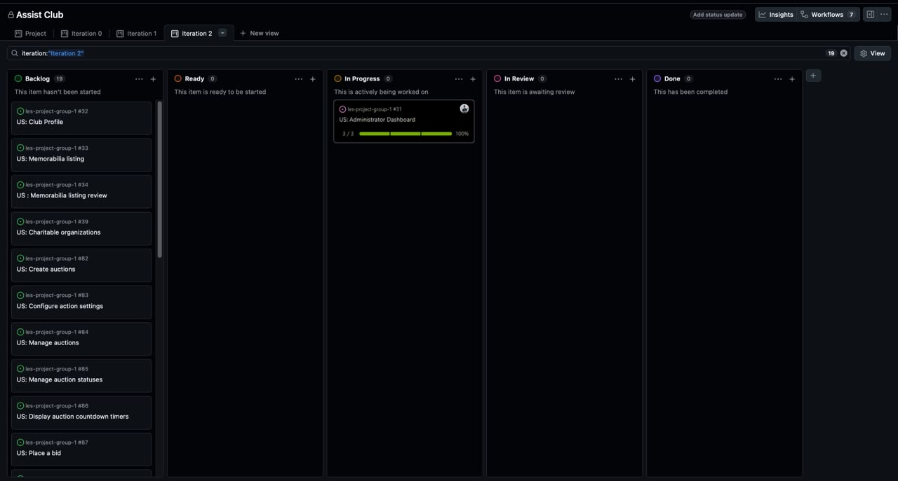
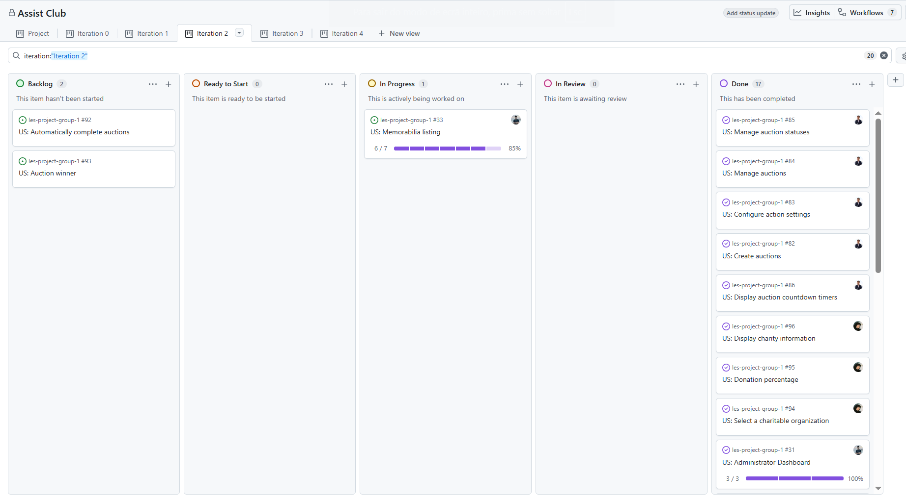

# Iteration 2 - Retrospective

## Snapshots

### Start

At the end of iteration 1, this was our project board:

At the start of iteration 2, this was our project board:

| Status      | Items |
| ----------- | ----- |
| Backlog     | 19    |
| Ready       | 0     |
| In progress | 1     |

The backlog contained the 15 issues planned for this iteration plus the 4 stories left over from iteration 1 ([#32](https://github.com/MESW-LES-2627/les-project-group-1/issues/32), [#33](https://github.com/MESW-LES-2627/les-project-group-1/issues/33), [#34](https://github.com/MESW-LES-2627/les-project-group-1/issues/34), [#39](https://github.com/MESW-LES-2627/les-project-group-1/issues/39)). [#31](https://github.com/MESW-LES-2627/les-project-group-1/issues/31) (Administrator Dashboard) was still in progress.

| Issue                                                                   | Story / task                                                          | Status      |
| ----------------------------------------------------------------------- | --------------------------------------------------------------------- | ----------- |
| [#89](https://github.com/MESW-LES-2627/les-project-group-1/issues/89)   | Display the highest bid                                                    | Backlog     |
| [#90](https://github.com/MESW-LES-2627/les-project-group-1/issues/90)   | Display bidding history                                                     | Backlog     |
| [#82](https://github.com/MESW-LES-2627/les-project-group-1/issues/82)   | Create auctions                                                       | Backlog     |
| [#83](https://github.com/MESW-LES-2627/les-project-group-1/issues/83)   | Configure action settings                                             | Backlog     |
| [#84](https://github.com/MESW-LES-2627/les-project-group-1/issues/84)   | Manage auctions                                                       | Backlog     |
| [#85](https://github.com/MESW-LES-2627/les-project-group-1/issues/85)   | Manage auction statuses                                               | Backlog     |
| [#86](https://github.com/MESW-LES-2627/les-project-group-1/issues/86)   | Display auction countdown timers                                      | Backlog     |
| [#87](https://github.com/MESW-LES-2627/les-project-group-1/issues/87)   | Place a bid                                                           | Backlog     |
| [#88](https://github.com/MESW-LES-2627/les-project-group-1/issues/88)   | Validate bids                                                         | Backlog     |
| [#91](https://github.com/MESW-LES-2627/les-project-group-1/issues/91)   | Track active bids                                                     | Backlog     |
| [#92](https://github.com/MESW-LES-2627/les-project-group-1/issues/92)   | Automatically complete auctions                                       | Backlog     |
| [#93](https://github.com/MESW-LES-2627/les-project-group-1/issues/93)   | Auction winner                                                        | Backlog     |
| [#94](https://github.com/MESW-LES-2627/les-project-group-1/issues/94)   | Select a charitable organization                                      | Backlog     |
| [#95](https://github.com/MESW-LES-2627/les-project-group-1/issues/95)   | Donation percentage                                                   | Backlog     |
| [#96](https://github.com/MESW-LES-2627/les-project-group-1/issues/96)   | Display charity information                                           | Backlog     |
| [#32](https://github.com/MESW-LES-2627/les-project-group-1/issues/32)   | Club Profile                                                          | Backlog     |
| [#33](https://github.com/MESW-LES-2627/les-project-group-1/issues/33)   | Memorabilia Listing                                                   | Backlog     |
| [#34](https://github.com/MESW-LES-2627/les-project-group-1/issues/34)   | Memorabilia Listing Review                                            | Backlog     |
| [#39](https://github.com/MESW-LES-2627/les-project-group-1/issues/39)   | Charitable Organizations                                              | Backlog     |
| [#31](https://github.com/MESW-LES-2627/les-project-group-1/issues/31)   | Administrator Dashboard                                               | In progress |

### End

At the end of iteration 2, this was our project board:

| Status | Items |
| ------ | ----- |
| Backlog     | 2    |
| Ready       | 0     |
| In progress | 1     |
| Done   | 17    |

| Issue                                                                   | Story / task                                                          | Status |
| ----------------------------------------------------------------------- | --------------------------------------------------------------------- | ------ |
| [#92](https://github.com/MESW-LES-2627/les-project-group-1/issues/92)   | Automatically complete auctions                                       | Backlog   |
| [#93](https://github.com/MESW-LES-2627/les-project-group-1/issues/93)   | Auction winner                                                        | Backlog   |
| [#33](https://github.com/MESW-LES-2627/les-project-group-1/issues/33)   | Memorabilia Listing                                                   | In progress   |
| [#82](https://github.com/MESW-LES-2627/les-project-group-1/issues/82)   | Create auctions                                                       | Done   |
| [#83](https://github.com/MESW-LES-2627/les-project-group-1/issues/83)   | Configure action settings                                             | Done   |
| [#84](https://github.com/MESW-LES-2627/les-project-group-1/issues/84)   | Manage auctions                                                       | Done   |
| [#85](https://github.com/MESW-LES-2627/les-project-group-1/issues/85)   | Manage auction statuses                                               | Done   |
| [#86](https://github.com/MESW-LES-2627/les-project-group-1/issues/86)   | Display auction countdown timers                                      | Done   |
| [#87](https://github.com/MESW-LES-2627/les-project-group-1/issues/87)   | Place a bid                                                           | Done   |
| [#88](https://github.com/MESW-LES-2627/les-project-group-1/issues/88)   | Validate bids                                                         | Done   |
| [#89](https://github.com/MESW-LES-2627/les-project-group-1/issues/89)   | Display the highest bid                                                    | Done     |
| [#90](https://github.com/MESW-LES-2627/les-project-group-1/issues/90)   | Display bidding history                                                     | Done     |
| [#91](https://github.com/MESW-LES-2627/les-project-group-1/issues/91)   | Track active bids                                                     | Done   |
| [#94](https://github.com/MESW-LES-2627/les-project-group-1/issues/94)   | Select a charitable organization                                      | Done   |
| [#95](https://github.com/MESW-LES-2627/les-project-group-1/issues/95)   | Donation percentage                                                   | Done   |
| [#96](https://github.com/MESW-LES-2627/les-project-group-1/issues/96)   | Display charity information                                           | Done   |
| [#32](https://github.com/MESW-LES-2627/les-project-group-1/issues/32)   | Club Profile                                                          | Done   |
| [#34](https://github.com/MESW-LES-2627/les-project-group-1/issues/34)   | Memorabilia Listing Review                                            | Done   |
| [#39](https://github.com/MESW-LES-2627/les-project-group-1/issues/39)   | Charitable Organizations                                              | Done   |
| [#31](https://github.com/MESW-LES-2627/les-project-group-1/issues/31)   | Administrator Dashboard                                               | Done   |

## What went well

- We completed 17 of the 20 items on the board, including the full auction flow: creating, configuring and managing auctions, statuses, countdown timers, placing and validating bids, highest bid, bidding history and tracking active bids.
- We closed most of the stories left over from iteration 1: [Club Profile (#32)](https://github.com/MESW-LES-2627/les-project-group-1/issues/32), [Memorabilia Listing Review (#34)](https://github.com/MESW-LES-2627/les-project-group-1/issues/34) and [Charitable Organizations (#39)](https://github.com/MESW-LES-2627/les-project-group-1/issues/39), as well as the [Administrator Dashboard (#31)](https://github.com/MESW-LES-2627/les-project-group-1/issues/31).
- We delivered the charity stories ([#94](https://github.com/MESW-LES-2627/les-project-group-1/issues/94), [#95](https://github.com/MESW-LES-2627/les-project-group-1/issues/95) and [#96](https://github.com/MESW-LES-2627/les-project-group-1/issues/96)) with the rules enforced on the server, not only in the forms.
- Most stories came with backend and frontend tests, and testing in the browser helped us catch problems that the automated tests missed.

## What did not go well

- We did not complete [Automatically complete auctions (#92)](https://github.com/MESW-LES-2627/les-project-group-1/issues/92) and [Auction winner (#93)](https://github.com/MESW-LES-2627/les-project-group-1/issues/93), so the auction cycle is still not closed from start to finish.
- [Memorabilia Listing (#33)](https://github.com/MESW-LES-2627/les-project-group-1/issues/33) is still in progress for the second iteration in a row, which shows that we still underestimated its size.
- We started the iteration with 19 items in the backlog, which was too much given that 4 of them were left over from iteration 1.
- Some problems were found late, such as the dashboard styles leaking into the public pages, the Stripe client breaking the tests and the old price showing after an edit.
- The rules for deleting, rejecting and cancelling a listing were confusing in the first version and we had to simplify them.

## What we will change in the next iteration

- Finish [#33](https://github.com/MESW-LES-2627/les-project-group-1/issues/33), [#92](https://github.com/MESW-LES-2627/les-project-group-1/issues/92) and [#93](https://github.com/MESW-LES-2627/les-project-group-1/issues/93) before taking on new stories.
- Count the leftover stories in the team's capacity when planning, and choose fewer new stories.
- Break large stories, such as [#33](https://github.com/MESW-LES-2627/les-project-group-1/issues/33), into smaller tasks that can be reviewed and merged separately.
- Check migrations, styles and external integrations in the running app and in CI before merging, instead of finding the problems afterwards.
- Agree on the meaning of unclear rules, such as who can delete, reject or cancel a listing, before starting to implement them.
