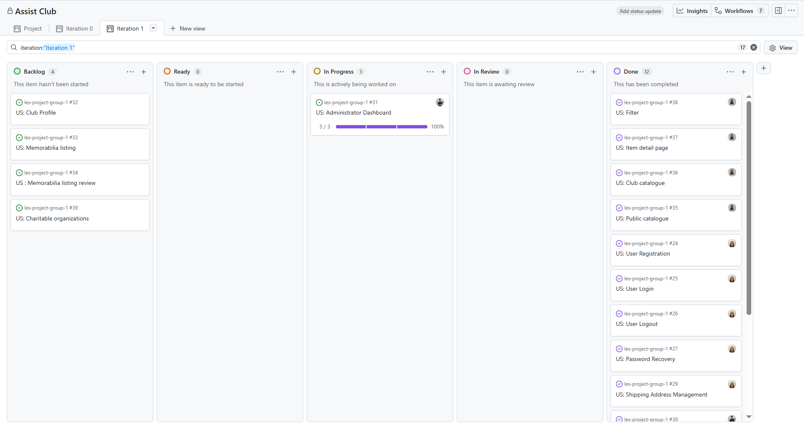

# Iteration 2 - Retrospective

## Snapshots

### Start

At the start of iteration 2, this was our project board:

| Status      | Items |
| ----------- | ----- |
| Backlog     | 23    |
| Ready       | 0     |
| In progress | 1     |

The backlog contained the 19 issues planned for this iteration plus the 4 stories left over from iteration 1. [#31](https://github.com/MESW-LES-2627/les-project-group-1/issues/31) (Administrator Dashboard) was still in progress.

| Issue                                                                   | Story / task                                                          | Status      |
| ----------------------------------------------------------------------- | --------------------------------------------------------------------- | ----------- |
| [#82](https://github.com/MESW-LES-2627/les-project-group-1/issues/82)   | Create auctions                                                       | Backlog     |
| [#83](https://github.com/MESW-LES-2627/les-project-group-1/issues/83)   | Configure action settings                                             | Backlog     |
| [#84](https://github.com/MESW-LES-2627/les-project-group-1/issues/84)   | Manage auctions                                                       | Backlog     |
| [#85](https://github.com/MESW-LES-2627/les-project-group-1/issues/85)   | Manage auction statuses                                               | Backlog     |
| [#86](https://github.com/MESW-LES-2627/les-project-group-1/issues/86)   | Display auction countdown timers                                      | Backlog     |
| [#87](https://github.com/MESW-LES-2627/les-project-group-1/issues/87)   | Place a bid                                                           | Backlog     |
| [#88](https://github.com/MESW-LES-2627/les-project-group-1/issues/88)   | Validate bids                                                         | Backlog     |
| [#91](https://github.com/MESW-LES-2627/les-project-group-1/issues/91)   | Track active bids                                                     | Backlog     |
| [#92](https://github.com/MESW-LES-2627/les-project-group-1/issues/92)   | Automatically complete auctions                                       | Backlog     |
| [#93](https://github.com/MESW-LES-2627/les-project-group-1/issues/93)   | Auction winner                                                        | Backlog     |
| [#94](https://github.com/MESW-LES-2627/les-project-group-1/issues/94)   | Select a charitable organization                                      | Backlog     |
| [#95](https://github.com/MESW-LES-2627/les-project-group-1/issues/95)   | Donation percentage                                                   | Backlog     |
| [#96](https://github.com/MESW-LES-2627/les-project-group-1/issues/96)   | Display charity information                                           | Backlog     |
| [#111](https://github.com/MESW-LES-2627/les-project-group-1/issues/111) | Backend: create CRUD APIs for memorabilia                             | Backlog     |
| [#112](https://github.com/MESW-LES-2627/les-project-group-1/issues/112) | Dashboard: create the page to add/edit memorabilia                    | Backlog     |
| [#113](https://github.com/MESW-LES-2627/les-project-group-1/issues/113) | Website: get memorabilia list from api                                | Backlog     |
| [#114](https://github.com/MESW-LES-2627/les-project-group-1/issues/114) | Backend: Middleware to prevent clubs to view/edit other clubs listing | Backlog     |
| [#116](https://github.com/MESW-LES-2627/les-project-group-1/issues/116) | Backend: Admin can change club state between "pending", "approved"    | Backlog     |
| [#117](https://github.com/MESW-LES-2627/les-project-group-1/issues/117) | Backend: Admin can confirm a listing added by a club                  | Backlog     |
| [#32](https://github.com/MESW-LES-2627/les-project-group-1/issues/32)   | Club Profile                                                          | Backlog     |
| [#33](https://github.com/MESW-LES-2627/les-project-group-1/issues/33)   | Memorabilia Listing                                                   | Backlog     |
| [#34](https://github.com/MESW-LES-2627/les-project-group-1/issues/34)   | Memorabilia Listing Review                                            | Backlog     |
| [#39](https://github.com/MESW-LES-2627/les-project-group-1/issues/39)   | Charitable Organizations                                              | Backlog     |
| [#31](https://github.com/MESW-LES-2627/les-project-group-1/issues/31)   | Administrator Dashboard                                               | In progress |

### End

At the end of iteration 2, this was our project board:

| Status | Items |
| ------ | ----- |
| Done   | 24    |

| Issue                                                                   | Story / task                                                          | Status |
| ----------------------------------------------------------------------- | --------------------------------------------------------------------- | ------ |
| [#82](https://github.com/MESW-LES-2627/les-project-group-1/issues/82)   | Create auctions                                                       | Done   |
| [#83](https://github.com/MESW-LES-2627/les-project-group-1/issues/83)   | Configure action settings                                             | Done   |
| [#84](https://github.com/MESW-LES-2627/les-project-group-1/issues/84)   | Manage auctions                                                       | Done   |
| [#85](https://github.com/MESW-LES-2627/les-project-group-1/issues/85)   | Manage auction statuses                                               | Done   |
| [#86](https://github.com/MESW-LES-2627/les-project-group-1/issues/86)   | Display auction countdown timers                                      | Done   |
| [#87](https://github.com/MESW-LES-2627/les-project-group-1/issues/87)   | Place a bid                                                           | Done   |
| [#88](https://github.com/MESW-LES-2627/les-project-group-1/issues/88)   | Validate bids                                                         | Done   |
| [#91](https://github.com/MESW-LES-2627/les-project-group-1/issues/91)   | Track active bids                                                     | Done   |
| [#92](https://github.com/MESW-LES-2627/les-project-group-1/issues/92)   | Automatically complete auctions                                       | Done   |
| [#93](https://github.com/MESW-LES-2627/les-project-group-1/issues/93)   | Auction winner                                                        | Done   |
| [#94](https://github.com/MESW-LES-2627/les-project-group-1/issues/94)   | Select a charitable organization                                      | Done   |
| [#95](https://github.com/MESW-LES-2627/les-project-group-1/issues/95)   | Donation percentage                                                   | Done   |
| [#96](https://github.com/MESW-LES-2627/les-project-group-1/issues/96)   | Display charity information                                           | Done   |
| [#111](https://github.com/MESW-LES-2627/les-project-group-1/issues/111) | Backend: create CRUD APIs for memorabilia                             | Done   |
| [#112](https://github.com/MESW-LES-2627/les-project-group-1/issues/112) | Dashboard: create the page to add/edit memorabilia                    | Done   |
| [#113](https://github.com/MESW-LES-2627/les-project-group-1/issues/113) | Website: get memorabilia list from api                                | Done   |
| [#114](https://github.com/MESW-LES-2627/les-project-group-1/issues/114) | Backend: Middleware to prevent clubs to view/edit other clubs listing | Done   |
| [#116](https://github.com/MESW-LES-2627/les-project-group-1/issues/116) | Backend: Admin can change club state between "pending", "approved"    | Done   |
| [#117](https://github.com/MESW-LES-2627/les-project-group-1/issues/117) | Backend: Admin can confirm a listing added by a club                  | Done   |
| [#32](https://github.com/MESW-LES-2627/les-project-group-1/issues/32)   | Club Profile                                                          | Done   |
| [#33](https://github.com/MESW-LES-2627/les-project-group-1/issues/33)   | Memorabilia Listing                                                   | Done   |
| [#34](https://github.com/MESW-LES-2627/les-project-group-1/issues/34)   | Memorabilia Listing Review                                            | Done   |
| [#39](https://github.com/MESW-LES-2627/les-project-group-1/issues/39)   | Charitable Organizations                                              | Done   |
| [#31](https://github.com/MESW-LES-2627/les-project-group-1/issues/31)   | Administrator Dashboard                                               | Done   |

## What went well

-

## What did not go well

-

## What we will change in the next iteration

-
